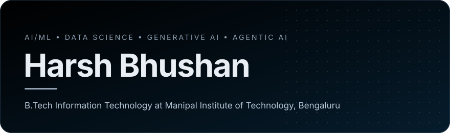
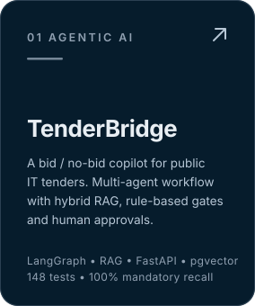
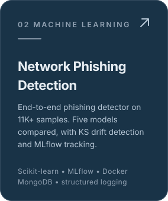
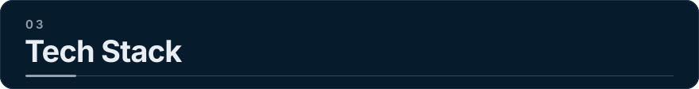
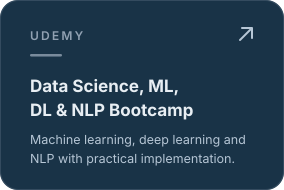

 

I'm Harsh, a B.Tech Information Technology student at Manipal Institute of Technology, Bengaluru. I build intelligent systems with machine learning, data science and agentic AI. I enjoy working across the full ML lifecycle, from data and experiments to deployment and AI-powered applications, and I learn best by building.

 

 

**Languages**

  
  

**ML & Data**

  
  
  
  
  
  
  

**GenAI & LLMs**

  
  
  
  
  
  

**Development**

  
  
  
  
  
  

**Tools**

  
  
  
  

 

 
